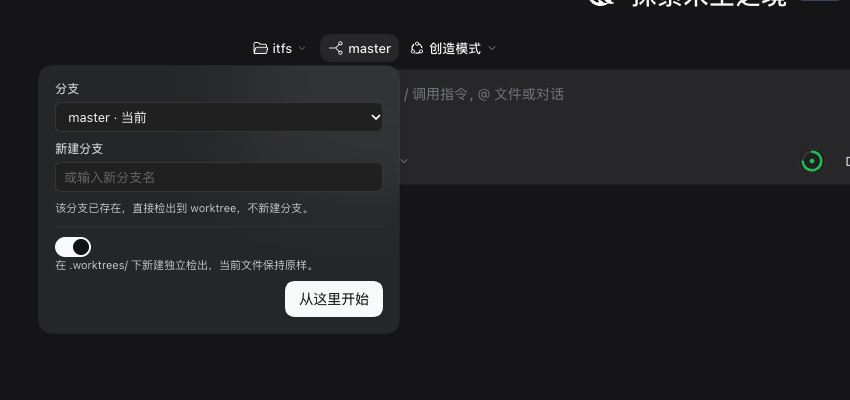

# dsh-branch-worktree

English | [简体中文](README.zh.md)

A [DeepSeek Harness](https://github.com/deepseek-ai/deepseek-harness) (DSH) Web UI plugin that adds a **branch picker with automatic Git worktree creation** to the New Session screen.

Pick the branch (or type a new branch name) right next to the workspace and agent-mode chips, then let DSH create an isolated checkout for it. The conversation starts inside that checkout, so nothing you have half-edited in your main working copy gets disturbed.




## Why

The New Session screen lets you choose a **workspace** and an **agent mode**, but a conversation always starts in the workspace directory as it is, on whichever branch is currently checked out. Parallel agent work therefore means juggling branches, stashing changes, or creating worktrees by hand before every session.

This plugin closes that gap with one extra chip:

| Control | Where it comes from |
|---|---|
| Workspace / project | DSH built-in |
| Agent mode (e.g. Creator) | DSH built-in |
| **Branch, or new branch + base** | **this plugin** |
| **Automatic worktree** | **this plugin** |

## What it does

- **Sits between the workspace and agent-mode chips** — the row reads project → branch → mode, which is exactly the order in which those decisions are made.
- **Opens as a dropdown, not a modal** — the composer stays visible and usable behind it.
- **Pick an existing branch, or type a new name** — a new branch is created from the base you choose (defaults to the repository's own default); an existing branch is reused instead of being recreated.
- **Toggles between two modes:**
  - **Create a worktree** (default) — `git worktree add` under `<repo>/.worktrees/<branch>`, then registers that directory as a DSH Workspace and starts the session there. Your current checkout is never touched, so uncommitted work stays exactly where it was.
  - **Switch in place** — `git checkout` the branch in the current checkout. Refused when the tree is dirty, so it can never clobber your changes.
- **Branches already checked out elsewhere are shown, not offered** — they are disabled in the picker with an `in use` marker, because Git refuses to check out the same branch twice.
- **The worktree pool stays out of `git status`** — the first run appends `.worktrees/` to `.git/info/exclude`.
- **Unsent draft is carried over** — if you already typed a prompt, it moves with you into the new session.
- **Not a Git repository? The chip disappears** instead of offering a dialog that cannot do anything.

The worktree layout it produces:

```
my-repo/
├── .git/
├── .worktrees/
│   ├── feature-login/      ← branch feature/login
│   └── fix-crash/          ← branch fix/crash
└── ... your main checkout, untouched
```

## Install

Requires DSH `>= 0.2.0` and `git` on `PATH`.

### From the Web UI (recommended)

1. Open the sidebar → **Plugins** → **Add plugin** → **Install a third-party plugin** (accepts npm packages, Git repositories, and local directories).
2. Paste the Git repository address:

   ```
   https://github.com/elfgzp/dsh-branch-worktree
   ```

3. Confirm, then switch on **Branch & Worktree** under **Installed plugins**. Restart DSH if the UI does not pick it up right away.

### Ask your agent to install it

In a DSH session with the plugin-manager tool enabled (Creator mode has it), just say:

> 从 https://github.com/elfgzp/dsh-branch-worktree 安装这个插件并启用

or in English:

> Install the plugin at https://github.com/elfgzp/dsh-branch-worktree and enable it

The agent calls `plugin_manager` with `install_bundle`, which adds the dependency to your profile, appends the bundle to `dsh.profile.bundles`, and activates it.

### Manual, for development

```bash
git clone https://github.com/elfgzp/dsh-branch-worktree
cd dsh-branch-worktree
```

Then install that absolute directory through **Plugins → Add plugin → Install a third-party plugin**. The profile records it as a `link:` dependency, so later edits need only a restart (or a page reload for the browser half).

> Never hand-edit the profile's `package.json` or `cordis.patch.yml`. The plugin manager owns those files; editing them directly desynchronizes the bundle list.

## Usage

1. Click **New Session**.
2. Choose your workspace, then click the **branch chip** in the middle.
3. In the dropdown, pick an existing branch, or type a name under *New branch* — a *based on* picker then appears.
4. Leave **Create worktree** on (the default), or turn it off to switch your current checkout instead.
5. Press **Start here** (or hit Enter in the name field).

The session opens in the resulting directory, and the workspace appears in the sidebar under the branch name.

### What the worktree toggle actually does

This is the part that is easy to misread: **"Create worktree" does not imply "create branch"**. The rule is:

| The branch name you give | What runs |
|---|---|
| **Does not exist** | `git worktree add -b <branch> <path> <base>` — **creates the branch** and checks it out in the new worktree |
| **Already exists** | `git worktree add <path> <branch>` — **reuses the branch**, creating nothing |
| **Checked out in another worktree** | Refused, because Git will not check out the same branch twice |

So a new name starts a new branch, an existing name reuses one, and you never get a surprise duplicate. The dropdown says which of the two is about to happen before you commit to it.

### What happens on disk

For a worktree run of branch `feature/login` in `/work/my-repo`:

```bash
# 1. the pool directory and its exclusion
mkdir -p /work/my-repo/.worktrees
echo '.worktrees/' >> /work/my-repo/.git/info/exclude

# 2. a new branch is created from the chosen base, or the existing branch is reused
git worktree add -b feature/login /work/my-repo/.worktrees/feature-login <base>

# 3. DSH registers /work/my-repo/.worktrees/feature-login as a Workspace
```

Nothing is ever deleted by this plugin. To retire a worktree:

```bash
git worktree remove .worktrees/feature-login
git branch -d feature/login
```

## Errors you may see

| Message | Meaning |
|---|---|
| This workspace is not inside a Git repository. | The selected workspace has no `.git`; the chip would not have been shown if this was known up front. |
| Branch names accept letters, digits and `. _ / -` only. | The typed branch name is not a valid Git ref. |
| That branch is already checked out in another worktree. | Git will not check out the same branch twice. Pick another branch, or create a new one. |
| A worktree directory with that name already exists. | A stale directory is in the way at `.worktrees/<branch>`. Remove it with `git worktree prune` or by hand. |
| Your current checkout has uncommitted changes. | You turned the worktree option off while the tree was dirty. Turn it back on, or commit/stash first. |
| Git refused the operation. | Any other Git failure; the Git message is shown in the dialog. |

## How it works

```
┌──────────────────────── Browser (client.js) ────────────────────────┐
│  conversation.hero.options slot occupant                            │
│    button  ──► Modal: branch select / new branch / worktree switch  │
│                        │                                            │
│                        │  POST /branch-worktree/create               │
└────────────────────────┼────────────────────────────────────────────┘
                         ▼
┌──────────────────────── Host (index.js) ────────────────────────────┐
│  connection.requestRejection()  ← trust fence, before anything else │
│  /branch-worktree/inspect  → repo, branches, worktrees, dirty state │
│  /branch-worktree/create   → git worktree add | git checkout        │
│                            → workspaceRegistry.create(path)         │
└─────────────────────────────────────────────────────────────────────┘
                         │
                         ▼   client calls uiWorkspace.startSession(id)
                  session created with header.cwd = the new checkout
```

Two details are worth knowing:

- **The session must be *created* in the worktree, not moved into it.** A DSH session's `header.cwd` is frozen creation metadata: the system prompt's cwd, the shell tool's default workdir, and the sandbox's `workspaceRoot` all derive from it. The plugin therefore registers the worktree as a Workspace and opens a blank session there, rather than mutating an existing session.
- **All Git work runs on the Host, never in the browser**, and always through `execFile` with a literal argv — no shell interpolation of branch names. Every route validates against the connection trust fence first, so a page from another origin cannot drive Git on your machine.

## Where it registers

| Half | Surface |
|---|---|
| Host | `webServer` exact routes `/branch-worktree/inspect`, `/branch-worktree/create` |
| Client | `conversation.hero.options` (list slot), id `branch-worktree`, order `-10` |

On sitting *between* the workspace and agent-mode chips: DSH ships **no slot** in that position. `conversation.hero.workspace` and `conversation.hero.agentPreset` are `display: contents` wrappers, and the only slot meant for extra controls — `conversation.hero.options` — is right-aligned at the end of the row. The plugin therefore injects a small scoped stylesheet that makes that container `display: contents` and uses `order` to place itself between the two shipped chips. The selectors are `:has()`-scoped to the New Session row, so conversation views are untouched, no other plugin's nodes are moved, and the block becomes irrelevant the day DSH grows a real slot there.

It depends on the shipped `@deepseek-ai/dsh-client-ui-conversation` plugin only, and uses no private APIs beyond the documented `webServer`, `connection`, `workspaceRegistry`, `slots`, `locale`, and `uiWorkspace` services.

## Compatibility

| DSH | Status |
|---|---|
| `0.2.1-rc.3` | tested |
| `>= 0.2.0` | expected to work |

Both `en` and `zh` locales ship with the plugin; the UI follows the DSH language setting.

## Uninstall

**Plugins** → **Branch & Worktree** → **Remove**. Worktrees and branches this plugin created are left on disk; clean them up with the `git worktree remove` commands shown above.

## Prior art

Before writing this, I looked for an existing plugin that covered the whole flow. These are the ones that exist:

| Repository | Stars | Why it was not enough |
|---|---|---|
| [frederico-kluser/dsh-worktree-jump](https://github.com/frederico-kluser/dsh-worktree-jump) | 2 | Worktree jumping only; no branch picker at session creation |
| [Letter2025/dsh-task-worktree](https://github.com/Letter2025/dsh-task-worktree) | 2 | Task isolation, no project/mode-integrated control |
| [YS-BW/dsh-plugins](https://github.com/YS-BW/dsh-plugins) | 1 | General plugin collection |
| [zhang-guo-wen/dsh-worktree](https://github.com/zhang-guo-wen/dsh-worktree) | 0 | Incomplete |
| [epik7th/dsh-task-worktree](https://github.com/epik7th/dsh-task-worktree) | 0 | Incomplete |
| [d0nj/dsh-plugins](https://github.com/d0nj/dsh-plugins) | 0 | General plugin collection |

None combined *project + agent mode + branch + automatic worktree* in the New Session row, so this plugin does exactly that and nothing else.

Note that DSH already ships a non-GUI worktree capability — `@deepseek-ai/dsh-experimental-worktree` with its `create_worktree` model tool — but it is off by default in every shipped profile and is model-driven rather than part of the New Session flow. This plugin complements it; the two do not conflict.

## License

MIT
